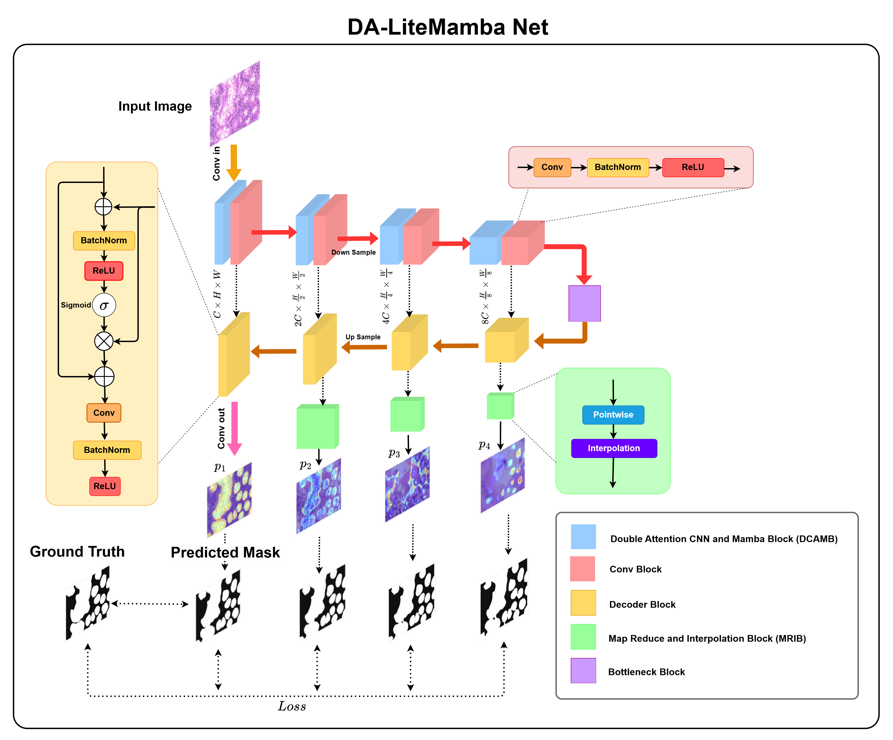

# [A Lightweight Hybrid CNN-Mamba Model with Dual Attention for Efficient Medical Image Segmentation](https://link.springer.com/chapter/10.1007/978-3-032-00972-2_53)

## Abstract

In the medical field, early diagnosis plays a crucial role and directly influences treatment methods. Particularly in image processing, identifying harmful cells is vital for health. With advancing technology, deep learning models have been widely applied in biomedical image analysis and segmentation to enhance efficiency and accuracy. CNN-based and Transformer-based models have been extensively researched and utilized. However, CNN models often struggle to capture long-range dependencies, while Transformers face challenges with quadratic computational complexity. To address these issues, a recent method called Mamba has emerged, by the building upon Mamba-based models, we propose a novel architecture, DA-Lite Mamba, incorporating Double Attention CNN and Mamba, ConvBlock, Bottleneck Block, Decoder Block and Map Reduce and Interpolation Block. Our work introduces two new feature extraction architectures: Double Attention CNN and Mamba and Bottleneck Block, which effectively leverage Depthwise Convolution and VSS Block to balance local and global information extraction, enhancing comprehensive feature representation while minimizing computational parameters. Additionally, we propose a novel loss calculation method based on the Matthews Correlation Coefficient (MCC) Loss to improve the convergence ability of deep learning networks. The proposed model is evaluated on two benchmark datasets: Sunnybrook Cardiac Dataset (SCD) and Data Science Bowl 2018 (DSB 2018). Experimental results demonstrate superior performance compared to previous CNN- and Transformer-based models across various evaluation metrics.


## Overview

<p align="center">
  
  <br>
  <em>Fig. 1: Overall architecture of the proposed DA-LiteMamba.</em>
</p>

DA-LiteMamba is a lightweight U-shaped segmentation network (**0.98M parameters, 0.21G FLOPs** at 160×160) that combines depthwise CNNs and Mamba (VSS blocks):

- **Double Attention CNN and Mamba (DACM) block**: the input is split along channels. One half goes through a VSS block (global context), the other half through a DW/PW conv block (local features). A **Double Attention Gate** lets each branch re-weight the other, and a **channel shuffle** mixes the two halves.
- **Bottleneck block**: pixel-wise channel and spatial attention (PCA + PSA).
- **Simple attention decoder** with gated skip connections.
- **Map Reduce and Interpolation Blocks (MRIB)**: three auxiliary decoder heads for deep supervision.
- **TCM loss** (Tan-hyperbolic Complement Matthews): `L_TCM = tanh(1 - MCC)`, applied to all 4 heads with weights `0.4, 0.3, 0.2, 0.1`.

## Results

**Sunnybrook Cardiac Dataset (SCD)**

| Method | Params | FLOPs | Endo DSC | Endo IoU | Epi DSC | Epi IoU | Avg DSC | Avg IoU |
|---|---|---|---|---|---|---|---|---|
| U-Net | 31.04M | 34.53G | 91.85 | 84.37 | 93.26 | 86.22 | 92.56 | 85.30 |
| Attention U-Net | 31.90M | 35.35G | 93.12 | 86.77 | 94.72 | 89.53 | 93.92 | 88.15 |
| CapNet | 1.53M | 1.83G | 94.00 | 88.95 | 95.93 | 92.30 | 94.97 | 90.63 |
| **DA-LiteMamba** | **0.98M** | **0.21G** | **94.80** | **90.13** | **96.52** | **93.28** | **95.66** | **91.71** |

**Data Science Bowl 2018 (DSB 2018)**

| Method | Params | FLOPs | DSC | IoU |
|---|---|---|---|---|
| U-Net | 31.04M | 46.12G | 91.35 | 84.29 |
| ResU-Net | 13.04M | 71.21G | 91.78 | 85.22 |
| U-Lite | 0.88M | 0.69G | 90.23 | 83.17 |
| **DA-LiteMamba** | 0.98M | **0.54G** | **92.03** | **85.61** |

See the paper for the full comparison and the ablation study of the Double Attention Gate.

## Installation

`mamba_ssm` requires Linux and an NVIDIA GPU with CUDA.

```bash
git clone https://github.com/<your-username>/DA-LiteMamba.git
cd DA-LiteMamba
pip install torch==2.4.0 torchvision --index-url https://download.pytorch.org/whl/cu121
pip install -r requirements.txt
```

## Data preparation

Images and masks are stored as NumPy arrays. Place them as follows:

```
data/
├── dsb2018/                 # 670 images resized to 256x256, 80/20 train/test split
│   ├── x_train.npy          # (N, 256, 256, 3) uint8
│   ├── y_train.npy          # (N, 256, 256)    uint8, values {0, 1}
│   ├── x_test.npy
│   └── y_test.npy
└── sunnybrook/              # 70/15/15 train/val/test split, center-cropped to 160x160 on the fly
    ├── Xtrain_endo.npy      # (N, H, W, 1) uint8
    ├── Ytrain_endo.npy      # (N, H, W, 1) values {0, 1}
    ├── Xval_endo.npy  / Yval_endo.npy
    ├── Xtest_endo.npy / Ytest_endo.npy
    └── ... same files with the _epi suffix
```

Other 2D datasets (e.g. GlaS, PH2, ISIC 2018) can be used with `--dataset npz`: put `train.npz` (and optionally `test.npz`) containing `image` and `mask` arrays in the data folder. Without `test.npz`, 20% of the training set is held out for testing.

## Training

```bash
# DSB 2018
python train.py --dataset dsb2018 --data-dir data/dsb2018

# Sunnybrook endocardium / epicardium
python train.py --dataset sunnybrook --data-dir data/sunnybrook --subset endo
python train.py --dataset sunnybrook --data-dir data/sunnybrook --subset epi
```

Defaults follow the paper: Nadam optimizer, learning rate 1e-3 halved by `ReduceLROnPlateau` on validation Dice, 200 epochs, TCM loss with deep supervision, mixed precision. The best checkpoint (by validation Dice) is saved to `checkpoints/<dataset>/`.

## Evaluation

```bash
python test.py --dataset dsb2018 --data-dir data/dsb2018 --ckpt checkpoints/dsb2018/<best>.ckpt
python test.py --dataset sunnybrook --data-dir data/sunnybrook --subset epi --ckpt <path/to/ckpt>
```

Reports Dice, IoU, precision, recall and F1.

Count parameters and FLOPs:

```bash
python tools/count_flops.py --in-channels 1 --size 160 160   # Sunnybrook
python tools/count_flops.py --in-channels 3 --size 256 256   # DSB 2018
```

## Repository structure

```
dalitemamba/
├── models/
│   ├── vss.py           # SS2D / VSS block (from VMamba)
│   ├── dacm.py          # Double Attention CNN and Mamba block, Double Attention Gate
│   ├── pcsa.py          # PCA / PSA bottleneck attention
│   └── dalitemamba.py   # Encoder, decoder and full network
├── losses.py            # MCC and TCM losses, deep supervision
├── metrics.py           # Dice, IoU, precision, recall, F1
├── optim.py             # Nadam optimizer
├── data.py              # Datasets and augmentation
└── module.py            # PyTorch Lightning module
train.py / test.py
```

## Acknowledgements

This research is funded by the Vietnam National Foundation for Science and Technology Development (NAFOSTED) under grant number 102.05-2021.34.
The SS2D/VSS implementation is adapted from [VMamba](https://github.com/MzeroMiko/VMamba) and uses the selective-scan kernel from [Mamba](https://github.com/state-spaces/mamba).

## Citation

```bibtex
@inproceedings{hoang2025dalitemamba,
  title     = {A Lightweight Hybrid CNN-Mamba Model with Dual Attention for Efficient Medical Image Segmentation},
  author    = {Hoang, Ngoc-Khai and Nguyen, Dinh-Hieu and Tran, Thi-Thao and Pham, Van-Truong},
  booktitle = {Conference on Information Technology and its Applications (CITA)},
  doi       = {10.1007/978-3-032-00972-2_53},
  year      = {2025}
}
```
